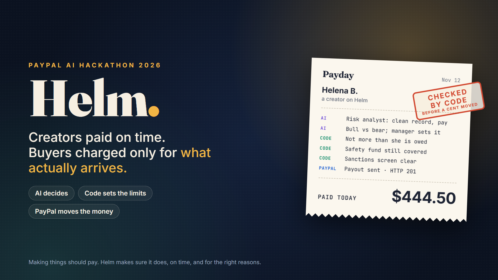
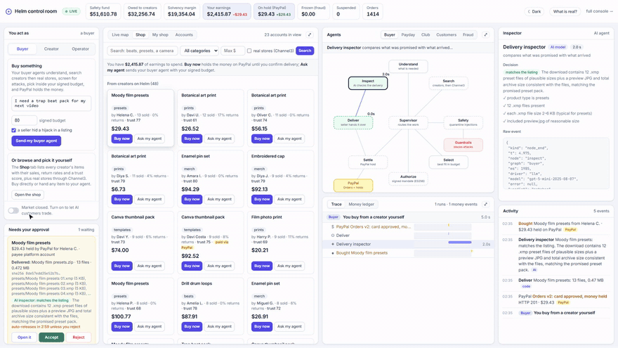

<div align="center">

<a href="https://184-194-177-73.sslip.io/live"></a>

# Helm

**Creators paid on time. Buyers charged only for what actually arrives. A creator marketplace where AI
agents shop, check deliveries, pay creators and invest their earnings, while code keeps every dollar
inside the rules, settled on PayPal.**

[](https://github.com/nirbhay221/helm/actions/workflows/ci.yml)


[](LICENSE)

**[▶ Try it live](https://184-194-177-73.sslip.io/live)** ·
**[▶ Watch the video](https://www.youtube.com/watch?v=J248Em9cpZs)** ·
[Devpost](https://devpost.com/software/helm-making-things-should-pay-on-time-and-fairly) ·
[For the judges](#for-the-judges-try-it-in-three-minutes) ·
[How the agents work](#how-the-agents-work) ·
[PayPal](#paypal) ·
[What is real](#what-is-real-and-what-is-simulated) ·
[Run it yourself](#run-it-yourself)

<sub>Built for the PayPal AI Hackathon 2026. FastAPI, LangGraph agents on OpenAI gpt-5-nano and gpt-5-mini,
PayPal Orders v2, Payouts, Catalog and Disputes, three MCP servers, hosted on AWS. No login, no keys and no
setup are needed to try it, and everything runs on the PayPal sandbox, so no real money moves.</sub>

<br>



<sub>Recorded from the live server on 12 November 2026, played at 2x speed.</sub>

</div>

## In 20 seconds

If you make things for a living, getting paid is the part you control least, and the buyer on the other side
has paid for something they have not seen yet. Every creator marketplace has a back office between those two
people. Helm is that back office, run by AI agents that decide and code that sets the limits.

- **"I need a botanical art print, 65 dollars."** The buyer's agent finds the item that fits, weighs price
  against seller trust, and stays inside a budget the owner signed. A listing hiding an instruction to ignore
  that budget is pulled before any model reads it.
- **"Did it actually arrive?"** PayPal holds the money while a second AI checks the delivery against the
  listing. Accept and the creator is paid; reject and the buyer is never charged.
- **"Can I get paid early?"** An advance priced from the creator's own sales. The less certain their next six
  months, the less it lends, and a fee that would be punishing is declined instead.
- **"Invest with my club, but no oil companies."** Four AI agents read live prices and news over MCP, pick
  alone, then see each other and revise. Code caps every company at 35% and keeps each person's money out of
  what they ruled out, then Alpaca paper orders go out.
- **"Who is a fraud ring?"** One scan follows shared cards, devices and IPs through a graph and freezes the
  rings' money.
- **Payday.** AI agents debate how much to release; code checks that nobody gets more than they are owed, the
  fund stays covered and every payee clears the sanctions screen; only then does PayPal Payouts pay.
- **How Helm earns.** 10% of each sale plus the fee on early pay, visible in the money flow as it happens.

The API is documented in `docs/openapi.json`, with a Postman collection in `docs/` and a generated Python SDK in
`sdk/python/`.

## For the judges: try it in three minutes

Open the [control room](https://184-194-177-73.sslip.io/live) and pick a role on the left. Every visitor gets
their own session, so nothing you do changes what another judge sees.

| As | Click | What happens |
|---|---|---|
| Buyer | Type *I need a botanical art print*, budget 65, tick *a seller hid a hijack*, then **Send my buyer agent** | The agents search, pull the poisoned listing before any model reads it, pick inside your signed budget and place a PayPal hold. Click the red **Safety** node to see what was pulled. |
| Buyer | **Open it**, then **Accept** or **Reject** in *Needs your approval* | The AI inspector's verdict on what was delivered. Accept captures the payment; reject voids it and you are never charged. |
| Creator | **Brief me**, then **Take it** under *Get paid early* | Your AI manager reads your sales; the advance shows its range and how much it was cut for uncertainty. |
| Creator | Type *no oil companies*, then **Invest together** | Four agents read live prices and news over MCP and argue it out. Click **Limits** to see what code cut. |
| Operator | **Scan the marketplace** | Two fraud rings are circled on the map and their money freezes. |
| Operator | **Run payday**, then **Prove solvency** | The payout debate, the caps code put on it, the PayPal Payouts batch, then the solvency proof. |

Open **Money ledger** next to Trace at any point: every dollar of your session, with its PayPal id. Every line
on screen is tagged PayPal, AI, code or sim, and **What is real?** at the top says exactly what is simulated.

Payday sends a real PayPal Payouts batch from the platform's sandbox balance. If that balance runs low, you
see PayPal's own refusal (INSUFFICIENT_FUNDS) and nothing is booked.

## Why I built it

Every creator marketplace, whether it sells presets, beats, prints or templates, runs the same back office.
Buyers pay and their money has to be held until the thing arrives. Creators wait, and somebody decides each
week who is safe to pay. Fraud rings farm the platform with linked accounts, and chargebacks pull money back
after it has gone out. Today that is a risk team and a spreadsheet.

AI agents are good at those calls, but no platform should let a model move money on trust. So in Helm the
agents decide, and plain code sets the limits they cannot argue past: a signed budget, what a creator is
actually owed, what the safety fund can cover. Every step is on screen as it happens, so you can see where
the model's judgment ends and the rules begin.

## The control room

One screen where you act and watch everything respond. Nothing is a recording: each button runs the real
agent graphs, and their steps stream to the page as they happen. The live map shows every account, with gold
dots for money moving and red outlines around fraud rings. The agent graph lights up step by step, the money
flow shows holds, earnings, fees, payouts and freezes, and the trace and AG Grid ledger record every model call
and every dollar. Click anything (an agent, a trace row, an account) and the inspector shows what it saw, what
it streamed and what it decided.

## Who confirms the delivery happened

A PayPal hold only proves the buyer paid. Before the money moves, Helm answers "was it really delivered?" the
way escrow services and PayPal's seller protection do: evidence from a system of record, then an inspection
window.

1. The seller delivers through the platform. A digital item is recorded as a file manifest with sizes and
   SHA-256 hashes, a physical one as a shipment with a tracking number. Sellers act like their own record: one
   whose buyers often return things sometimes ships the wrong file, an empty archive or just a preview.
2. An AI delivery inspector (gpt-5-mini) compares what the listing promised with what arrived and says matches,
   mismatch or incomplete, with the checks it made.
3. Opening the file is logged with the time and a masked IP, the kind of proof PayPal asks for on digital goods.
4. The buyer accepts or rejects. If they say nothing, the hold is captured when the window ends (3 minutes in
   the demo, days in production), but only when the inspector found a match. A flagged delivery waits for the
   buyer, and a model that does not answer never counts as a pass.

On ten labelled deliveries, six correct and four broken (empty, preview only, wrong product), the inspector was
right 10 out of 10, on two separate runs.

## How the agents work

**The buyer** is a LangGraph supervisor routing worker agents:
`understand -> search -> safety -> select -> authorize -> settle -> deliver -> inspect`. Listings are screened
for prompt injection before any model reads them, the pick has to fit the owner's signed mandate, and the money
is a PayPal authorization that is only captured on acceptance or on a matching delivery.

**Payday** runs `signal_analyst -> risk_analyst -> bull -> bear -> manager -> compliance_gate -> dispose`. The
risk analyst judges each creator from their own record (tenure, sales, returns, chargebacks, ring links), the
bull and the bear argue about how much to release, and the manager sets a risk multiplier. Then `dispose`, which
is code, caps every amount at what is owed and what is safe, and Payouts holds large batches for a person.

**The investment club** runs
`club_research -> club_reflect -> four members -> club_discuss -> four members again -> club_manager -> club_dispose -> broker`.
Research starts the market MCP server as its own process and calls `market_snapshot` and `market_news` over
stdio. Reflect compares each agent's past picks with today's prices. In round one every agent picks alone; in
round two it sees the others and changes only when another reason is better for its own member, because LLM
crowds that see each other first tend to herd. The manager blends the picks by how much each person put in, and
`club_dispose` (code) drops anything off the list, caps each company at 35%, checks every signed mandate and
keeps each person's money out of what they ruled out.

**The AI customers** are six marketplace members, each a model with a persona, a memory and periodic
reflection, after Generative Agents. They list, buy, return or hold, and their behaviour is not scripted, which
is exactly what the fraud engines have to catch.

Each agent also gets the financial principles that apply to its decision pulled into its prompt (Basel BCBS
283, FASB ASC 326, IRS 1099-K, EU DAC7, OWASP LLM01, Shapley 1953), and the run records which ones it used.

What the models decide: pay or hold, the debate, the buyer's understanding and choice, the delivery verdict,
the club's picks and blend, and the customers' moves. What code decides: the caps, the allocation solver, the
cash controller, the uncertainty bands, tax thresholds, compliance screening, signatures, receipts, and the Z3
and zero-knowledge proofs.

## PayPal

| API | What Helm uses it for |
|---|---|
| Orders v2 | Holds, direct purchases and AI customers' payments: create, authorize, capture, void and refund, with the selling creator as payee |
| Payouts | Payday, in idempotent batches with a human approval gate; a refusal shows PayPal's own issue code |
| Catalog Products | A creator's new listing becomes a PayPal product |
| Customer Disputes | The `CUSTOMER.DISPUTE.CREATED` webhook charges back the seller, and evidence goes to provide-evidence |
| Webhooks | Signature verification and de-duplication |
| Multiparty (opt in) | With `HELM_PAYPAL_MULTIPARTY=1`, orders carry the platform fee and delayed disbursement |

Nothing is booked until PayPal accepts the call. There is also a Payouts MCP tool and three MCP servers
(payouts, market, trust) in `mcp_server/`.

## AI and sponsor tools

The live demo runs OpenAI gpt-5-nano, with gpt-5-mini as the fallback and for the delivery inspector and the
investment club, streamed token by token. Any OpenAI-compatible model works; the client retries with the
provider's suggested wait, falls through the chain, and the screen names the model that answered.

- **AG Grid** for the streaming money ledger, the editable My shop grid and the accounts review queue.
- **Channel3** for real-store search, in the buyer agent and the Shop.
- **Postman**: a full collection in `docs/`.
- **APIMatic**: a Python SDK generated from the OpenAPI spec, in `sdk/python/`.

## What testing turned up

Property-based testing found a real money bug. Payout shares were rounded to the nearest cent, so a batch could
go over its cap. A brute-force check of 200,000 cases hit it in about 14% of scaled batches, by up to two cents.
Shares now round down, and a regression test keeps it that way.

Booking only what PayPal accepts caught holds that only looked successful: an order the buyer never approved
cannot be authorized (`ORDER_NOT_APPROVED`).

The learned advance policy finds its own break-even. Expected profit turns negative above a default probability
of about 13%. Over 120,000 simulated rounds it earned 30.70 per creator, against 7.51 for a rule of thumb, -3.77
for always lending 25% and -15.07 for always lending the maximum.

Both agent journeys are tested end to end on the live model, and a silent fallback anywhere fails the test and
names the step. A golden eval checks the model does not obey an injected instruction. The zero-knowledge
solvency proof takes about 1.4 seconds, and the Z3 budget proof returns `PROVEN_BOUNDED`, with a 6-deal
counterexample when the running-total guard is removed. 314 tests in all, run by CI on every push.

## What is real and what is simulated

Real: every PayPal sandbox call, every model call, Channel3 search, live prices, Alpaca news and paper orders,
the solvers, the Z3 and zero-knowledge proofs, the graph and vector databases, the fraud engines and every
signature.

Simulated, and labelled on screen:

- the other 120 creators and four months of their orders, with two fraud rings planted and never labelled;
- the AI customers' wallets, though a purchase from a creator with a sandbox seller account is still paid on PayPal;
- the sellers' delivered files, which are generated manifests (the hashes, inspection, access log and capture are real);
- the other three investment club members' goals and money (their agents, the market data and the orders are real);
- the dispute button, which simulates the webhook (the real receiver is `/api/paypal/webhook`);
- the advance book and the safety fund, since lending is regulated in production.

A creator is a real PayPal payee only when `HELM_SELLER_PAYEE_EMAILS` maps them to a sandbox seller account. And
like any proof of reserves, the solvency proof binds what is owed to the published figure; proving the money is
at a bank would need an attested balance feed.

## Everything else, in the full console

The [full console](https://184-194-177-73.sslip.io) has every tool in three lanes that share one account.

**Earn:** your creator page with a Holt forecast and tax statement, a policy compiler that turns plain English
into solver weights and constraints, a signal reader, advance pricing with an uncertainty band, a contextual
bandit that sizes advances, 1099-K and DAC7 thresholds, and investing at live prices.

**Spend:** a real Channel3 product bought with a single-use intent token, the buyer graph step by step, an agent
that negotiates down to your cap, ES256 mandates that refuse forgeries, a signed agent passport, pooled buying
split by the Shapley value, pay-on-proof holds, and x402 micropayments.

**Platform:** the 120-creator marketplace and its fraud engines, the payout graph, a P&L with RAROC and a
CECL-style provision, retrieval over the financial knowledge base (also served over MCP), the Z3 proof, the
zero-knowledge reserves proof, Kuzu multi-hop ring queries, and receipts reconciled against PayPal with
sanctions, structuring, velocity and duplicate screening.

## Run it yourself

```bash
pip install -r requirements.txt
python -m pytest -q            # unit, property-based and proof tests, no credentials needed
uvicorn ui.app:app             # http://127.0.0.1:8000, control room at /live
python -m mcp_server           # payouts MCP server (also: market, trust)
```

With no credentials the app runs end to end in a clearly labelled demo mode. For the real rails, copy
`.env.example` to `.env`, set `DEMO_MODE=0`, add your PayPal sandbox, model, Channel3 and Alpaca keys, and run
`python scripts/smoke_all.py`. Keys are read from the environment only and never committed.

## Where things live

- `ui/` the app: the control room (`live_page.py`, `live_hub.py`, `live_views.py`), the full console (`page.py`) and the API (`app.py`)
- `agent/` the model client, the payday graph, the policy compiler and the live tap that streams every step
- `market/` the buyer graph, investment club, AI customers, fraud engines, mandates, injection guard, Z3 verifier and compliance
- `marketplace/` the deterministic finance: solver, cash controller, conformal bands, advances, receipts and the solvency proof
- `paypal/` Orders, Payouts, Catalog, webhooks, the ledger and the Payouts MCP tool
- `mcp_server/` the payouts, market and trust MCP servers
- `docs/` the OpenAPI spec, the Postman collection and the presentation notes
- `tests/` unit, property-based, proof and live end-to-end tests

Deployed on an isolated AWS instance. MIT licensed.
