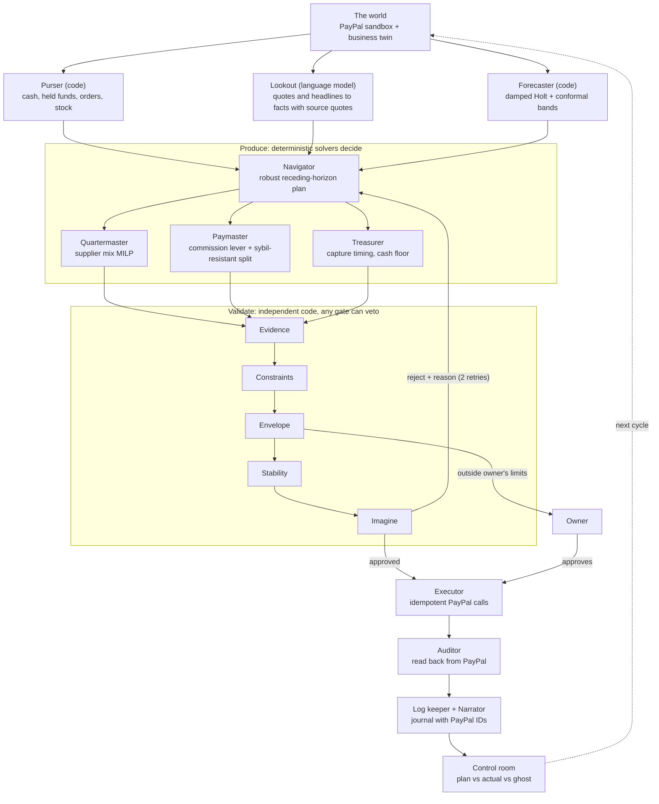

# Helm architecture (v2)

Helm is a closed loop. Each week it measures the gap between the owner's plan and what actually happened, **produces** money moves to close it, has an independent **validator** try to break those moves, and only then executes them on PayPal. Money comes in through Orders and goes out through supplier purchases (saved PayPal wallet at each supplier) and affiliate commissions (Payouts).

## Roles

| Role | Kind | Job |
|---|---|---|
| Purser | code | Reads spendable cash, PayPal-held funds, orders and stock |
| Lookout | language model | Reads supplier quotes and headlines into facts; every number must be quoted from its source |
| Forecaster | code | Damped Holt on outlier-clipped history; split-conformal band calibrated on raw errors (`helm/forecast/conformal.py`) |
| Navigator | solver (LP) | Plans H weeks across low / middle / high scenarios, commits only this week's move shared by all scenarios; levers are orders per lead-time class and the commission rate; models PayPal holding part of a spike (`helm/produce/navigator.py`) |
| Quartermaster | solver (MILP) | All-units tier discounts, minimum orders, capacity, fixed fees (`helm/produce/quartermaster.py`) |
| Paymaster | solver | Commission split with caps and hold-backs against fake accounts (next) |
| Validator | code | Five gates, shares no decision code with the producer (`helm/validate/gates.py`) |
| Orchestrator | state machine | Fixed order of steps and retry policy (`helm/loop.py`) |
| Narrator | language model | Explains each cycle from the journal; cannot change numbers |

## Validator gates

1. **Evidence**: each model-read fact must quote a sentence that is in the source, every number it depends on must appear in that quote, and values must be in bounds.
2. **Constraints**: recomputed independently: minimum orders, capacity, tier prices, fees, spend against *spendable* cash (held funds excluded), the cash floor, allowed Payouts purposes, and no paying suppliers through Payouts.
3. **Envelope**: the owner's limits. Outside them the plan is escalated to the owner, not rejected.
4. **Stability**: re-plans with demand nudged by 5% either way; a plan whose order or commission swings wildly is sent back.
5. **Imagine**: runs the plan and "do nothing" through copies of the twin on the same random draws, using the Validator's own simpler forecaster. The plan must beat doing nothing and keep the chance of breaching the cash floor low. The "do nothing" path is the ghost line in the control room.

On a reject the producer re-plans with an adjustment that answers the reason: cut spend after a cash reject, take the smallest order across nudged forecasts after an instability reject, weigh cash more after losing to doing nothing. After two rejections Helm holds.

## Why this design (research)

- **Models read and explain, solvers decide.** LLMs used as end-to-end inventory solvers pay a "hallucination tax"; a hybrid where the model extracts parameters and a solver decides cut cost 32.1% vs GPT-4o end to end, and perfect information did not fix the model's version. Duan, Hu, Jiang, [arXiv 2601.00121](https://arxiv.org/abs/2601.00121).
- **Repeatable decisions.** AI agents in the MIT Beer Game beat humans on average but show "agent bullwhip": big run-to-run swings that repeated sampling does not fix. Long, Simchi-Levi et al., [arXiv 2605.17036](https://arxiv.org/abs/2605.17036). Helm's decider is deterministic and the Stability gate tests for swings.
- **External verification, not self-checking.** LLMs asked to verify themselves often make answers worse; gains come from sound external verifiers. Huang et al., [arXiv 2310.01798](https://arxiv.org/abs/2310.01798); CRITIC, [arXiv 2305.11738](https://arxiv.org/abs/2305.11738).
- **Extracted facts are hypotheses until tied to evidence.** Contract2Plan, [arXiv 2601.06164](https://arxiv.org/abs/2601.06164).
- **Verification failures are their own failure class in multi-agent systems.** MAST, NeurIPS 2025, [arXiv 2503.13657](https://arxiv.org/abs/2503.13657).
- **Imagine before acting.** Reason-Imagine-Act, [arXiv 2605.24004](https://arxiv.org/abs/2605.24004).
- **Plan for the spread.** Conformal decision-making for inventory, [arXiv 2412.13159](https://arxiv.org/abs/2412.13159), [arXiv 2609.23170](https://arxiv.org/abs/2609.23170).
- **Referral rewards can't be fully sybil-proof**, so cap and hold back. [arXiv 1304.7432](https://arxiv.org/abs/1304.7432), [arXiv 2005.13224](https://arxiv.org/abs/2005.13224).
- **Simple, explicit agent structure** with an evaluator-optimizer loop (Anthropic, *Building effective agents*); a separate risk gate after the decider as in TradingAgents and FinCon ([arXiv 2407.06567](https://arxiv.org/abs/2407.06567)).

## Benchmark (`python -m helm.bench`)

8 seeds x 30 weeks, a creator video triples demand for 3 weeks from week 14:

| Captain | Inventory gap (units/wk) | Lost sales (units) | Weeks under cash floor | Final cash | Bullwhip ratio |
|---|---|---|---|---|---|
| Do nothing | 375.7 | 4288.4 | 0.0 | 14,294 | 0.00 |
| Reorder rule, one supplier | 327.1 | 504.7 | 0.0 | 69,533 | 12.70 |
| Helm without Lookout | 97.0 | 216.6 | 0.0 | 67,616 | 1.57 |
| Helm | 84.0 | 122.2 | 0.0 | 69,171 | 2.22 |

Next: an LLM-only captain for the same benchmark, the Paymaster with sybil attackers, and the PayPal executor.
